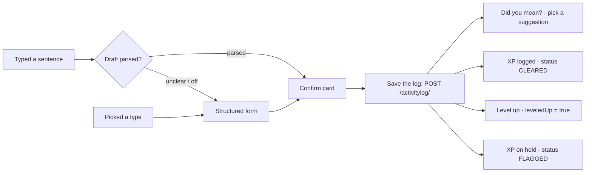

# Etram — Design Plan: Home, Log Activity, Log Result

Oct 19, 2026 · @Prashant Singh

## Summary

Your sketches describe a three-screen core loop: **Home → Log Activity → Log Result**. The layout works and the backend can drive almost all of it today. The plan keeps your structure and makes four changes:

1. **Add a confirm step to natural-language logging.** `POST /activitylog/natural` only returns a *draft*; nothing is saved until the app sends it to `POST /activitylog/`. The user should always see what was understood before XP is awarded.
2. **Ask "how long" and "when", not just "hours".** The backend needs a start and end time. Ask for duration plus "ended at" (default: now) and compute the start.
3. **Give Log Result four states, not one.** Cleared, levelled up, pending review (XP withheld) and rejected each need different screens.
4. **Show names on leaderboards.** Leaderboard rows only return `userId`, so the backend needs a display-name lookup before the two leaderboard cards on Home can show people.

## What the sketches show

Each sketched element maps to an existing endpoint, except where noted.

| Screen | Sketched element | Intent | Backed by |
| --- | --- | --- | --- |
| Home | Floating nav bar | Brand, notifications, account | `GET /notifications/unread-count` |
| Home | Log activity button with choices | Fast entry into logging | `GET /activity/` (catalog) |
| Home | Leaderboard for user's rank | Where I stand in my tier | `GET /ranks/me`, `GET /ranks/me/leaderboard` |
| Home | Global leaderboard with choice to change ranks | Browse any tier's board | `GET /ranks/{tier}/leaderboard`, `GET /leaderboard` |
| Home | This week's activity tracks | Weekly progress at a glance | `…/analytics/user/{id}/weekly-report`, `GET /activitylog/streaks/user/{id}` |
| Home | Floating footer | Primary navigation | — |
| Log Activity | Activity type + hours | Structured entry | `POST /activitylog/` |
| Log Activity | "or" free-text box | Natural-language entry | `POST /activitylog/natural` (draft only) |
| Log Result | Header | Success / status banner | `ActivityLogResponse.reviewStatus`, `leveledUp` |
| Log Result | Activity logged · time logged · XP gained | The receipt | `activity`, `durationMinutes`, `xpEarned` |
| Log Result | Other analytics | Context after logging | streak fields + weekly report |

## Home

Home answers one question: "What should I do next to climb?" Modules are ordered by how often they drive an action, top to bottom on mobile.

1. **Floating nav bar** — Etram mark, level chip (e.g. *Lv 7*), notification bell with unread badge, avatar menu. It floats with 12px inset and a translucent surface; it hides on scroll down and returns on scroll up.
2. **Log activity card (hero of the page)** — the largest card, accent-filled. Three to five *quick-pick chips* for the user's most-logged activities, plus a "Something else…" chip. A chip opens Log Activity with the type pre-filled. Uses `GET /activity/` until a "recent activities" endpoint exists (derive from history for now).
3. **My rank card** — tier name and icon, position ("#14 of 120"), percentile, and the 5 people just above and below the user in their tier. Highlight the user's row. Tap opens Rank & Leaderboards.
4. **Global leaderboard card** — a horizontal tier switcher (Basecamp → Summit chips) above the top 5 of the chosen tier. Default to the user's own tier, so the two leaderboard cards differ by showing *neighbours* vs *the top*.
5. **This week's tracks** — a 7-day strip (Mon–Sun) of daily XP bars from `weeklyReport.dailyBreakdown`, week-over-week change (`percentageChange`), and one row per active streak with its flame count and "log today to keep it" when not yet logged.
6. **Floating footer** — bottom tab bar: Home · Ranks · **\[+ Log\]** · Stats · More. The centre button is raised and accent-coloured; it is the same action as the Log card, always reachable.

**Desktop (≥ 1024px):** nav stays on top; footer tabs move to a left rail; content becomes a 12-column grid — Log card and Weekly tracks span 8 columns on the left, the two leaderboard cards stack in the right 4.

**Empty state (new user):** the leaderboard cards show the tier ladder with "Log your first activity to get ranked"; weekly tracks show seven empty bars with a dashed outline.

## Log Activity

Log Activity opens as a bottom sheet on mobile (a centred modal on desktop) so Home stays visible behind it. Both of your entry modes lead to the same **confirm card** before anything is saved.

**Layout, top to bottom**

1. **"Tell us what you did" text box** — placeholder *"Studied Spring Boot for 90 min this morning"*. Put this first: it is the faster path and the app's differentiator. Submit calls `POST /activitylog/natural`.
2. **"or" divider.**
3. **Structured row** — activity type (searchable select over the catalog, grouped by category), duration stepper (15-minute steps, quick chips 15 · 30 · 60 · 90 min), and "Ended" (default *Just now*; options *1 hour ago*, *This morning*, *Pick time*). Start time = end − duration. Optional notes field collapsed under "Add a note".
4. **Confirm card** — shows activity, start–end and duration. For natural input it also shows the backend's `interpretation` sentence ("Logged 90 min of Study, 8:00–9:30 today"). Buttons: **Log it** (`POST /activitylog/`) and **Edit** (turns the card into the structured form, pre-filled).

**States the sheet must handle**

| Situation | Source | What the user sees |
| --- | --- | --- |
| Draft parsed | natural `status = PARSED` | Confirm card with the interpretation |
| Needs clarification | natural `status = NEEDS_CLARIFICATION` | The interpretation as a question + the structured form pre-filled with what was understood |
| AI logging off or down | natural `status = DISABLED` / `UNAVAILABLE` | Hide the text box (DISABLED) or show "Quick log is unavailable, use the form" (UNAVAILABLE) |
| Name auto-resolved | `nameResolution` present | Inline note: "Logged as *Running* (you typed *morning jog*)" with an Undo |
| No match | 404 with `suggestions` | "Did you mean…?" chips; tapping one fills the type |
| Too long / in the future | 400 validation | Inline error on duration or time, never a toast |

Both paths meet at the confirm card; only "Save the log" calls `POST /activitylog/`, and its response picks the Log Result header.

## Log Result

Log Result is a full-screen moment, not a toast: it is the payoff of the loop. Your three-part layout (header → receipt → analytics) stays; the header changes with the outcome.

**Header by outcome** (from `ActivityLogResponse`)

| Outcome | Condition | Header | Motion |
| --- | --- | --- | --- |
| Logged | `reviewStatus = CLEARED`, `leveledUp = false` | "+120 XP" counting up, activity name below | XP counter, 600 ms |
| Level up | `leveledUp = true` | "Level 8!" with the level badge, then the XP line | Badge scale-in + accent burst, then counter |
| Pending review | `reviewStatus = FLAGGED` | "Saved — XP on hold" in pending grey, with "Unusually long session; an admin will review it" | None (calm, not celebratory) |
| Rejected (seen later in History) | `reviewStatus = REJECTED` | Not shown here; History shows the row with a reason | — |

**Receipt row** — your three chips: *Activity logged* (name + category icon), *Time logged* (`durationMinutes` as "1 h 30 min" + the time range), *XP gained* (`xpEarned`). Under XP, a small breakdown when multipliers applied: "×1.5 bonus" (`bonusApplied`, `bonusMultiplier`) and "×1.2 streak" (`streakMultiplier`).

**Other analytics** — three compact cards, each one tap away from its full screen:

- **Streak** — "6-day streak" card using `currentStreak` (drawn with a flame icon, not an emoji), plus the longest streak for that activity.
- **This week** — the same 7-day XP strip as Home, with today's bar animating up by the XP just earned.
- **Rank nudge** — "You're 340 XP from Ridge". Needs the XP of the tier boundary; until an endpoint exposes it, show the current tier and position instead.

**Actions** — primary **Done** (back to Home), secondary **Log another**. Pending-review results show only **Done**.

## App-wide design system

These rules carry the hero's look into every screen, so the three screens above and the remaining twelve feel like one app.

**Navigation shell**

| Viewport | Top | Primary nav | Log action |
| --- | --- | --- | --- |
| Phone (< 768px) | Floating nav bar | Floating bottom tab bar, 5 slots | Raised centre button |
| Tablet (768–1023px) | Floating nav bar | Bottom tab bar | Raised centre button |
| Desktop (≥ 1024px) | Nav bar | Left rail, icons + labels | Accent button at the top of the rail |

**Core components** (build these first; every screen is assembled from them)

| Component | Used on | Notes |
| --- | --- | --- |
| Card | Everywhere | `--surface`, 1px `--line` border, 20px radius, 20px padding |
| XP bar | Home, Result, Activity detail | Accent fill on `--line` track; label in JetBrains Mono |
| Tier badge | Home, Ranks, Result | One mountain glyph per tier, Basecamp low → Summit tall |
| Leaderboard row | Home, Ranks | Position · avatar · name · XP; the user's own row highlighted |
| Quick-pick chip | Home, Log | 44px tall; category icon + name |
| Week strip | Home, Result, Stats | 7 bars, today outlined, values from `dailyBreakdown` |
| Streak pill | Home, Result | Flame icon + count, `--streak` colour |
| Status pill | Result, History, Admin review | Cleared / Pending / Approved / Rejected |
| Bottom sheet | Log, filters | Drag handle, snaps to 60% and 92% height |

**Tokens** — reuse the hero's: background `#0D0F14`, surfaces `#141821` / `#1C212B`, line `#262C38`, text `#F3F1EA` / `#9AA3B2`, accent `#C8F25A`, XP `#FFB547`, streak `#FF8A3D`, rank `#8FA8FF`. Add one: **pending** `#B4BCC9` (cool grey) with a clock icon, so withheld XP never looks like earned XP orange. Fonts: Bricolage Grotesque (display), DM Sans (body), JetBrains Mono (numbers).

**Motion** — only on earned moments: XP count-up, level-up burst, rank marker climb, bar growth. Durations 200–600 ms. Everything respects `prefers-reduced-motion`.

**Accessibility** — 44px touch targets; text contrast 4.5:1; status never by colour alone (pill always has a word); leaderboards are real tables for screen readers.

## Backend gaps and next steps

Three sketched elements need backend work; the rest can be built against today's API.

| Gap | Affects | Suggested change |
| --- | --- | --- |
| Leaderboard rows have only `userId` | Both leaderboard cards on Home, Ranks | Add `displayName` (and optional `avatarUrl`) to `LeaderboardEntryDto` / rank leaderboard responses, joined from the gateway's user table |
| No "my recent activities" | Quick-pick chips on Home and Log | `GET /activitylog/user/{id}/recent-activities?limit=5`, or derive from history client-side for now |
| No XP-to-next-tier figure | Rank nudge on Log Result | Expose the XP at the next tier boundary on `GET /ranks/me` |

Ranks are recomputed every 5 minutes, so a fresh log may not move the rank card right away. Show "Rank updates every few minutes" under it rather than implying an instant change.

**Next steps**

- [ ] Mock up the three screens at phone width (390px) on the Etram design canvas
- [ ] Build the nine core components and the navigation shell
- [ ] Wire Log Activity end to end, including the confirm step and all six states
- [ ] Open backend issues for the three gaps above
